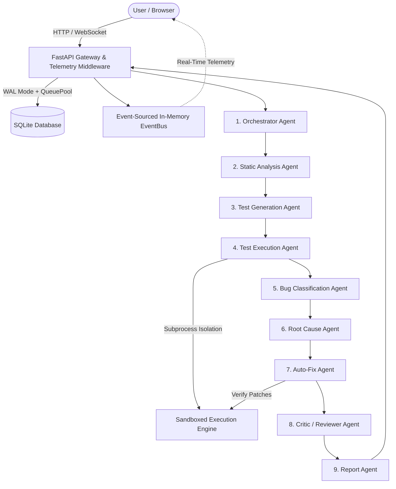

# SentinelMesh 🛡️
### Intelligent Multi-Agent Software Testing & Self-Healing Bug Analysis Platform

[](https://www.python.org/)
[](https://fastapi.tiangolo.com/)
[](https://react.dev/)
[](https://tailwindcss.com/)
[](#testing--verification)
[](#)

> **SentinelMesh** is an autonomous multi-agent quality engineering platform where a team of 9 cooperating AI agents analyzes software repositories, synthesizes boundary tests, executes sandboxed test runs, classifies bugs, traces causal root causes, and **automatically verifies proposed fixes in an isolated sandbox before presentation**.

---

## 🏛️ Architecture Overview



---

## 🌟 Key Innovations

1. **Self-Healing Verification Loop:** Generates tests $\rightarrow$ detects failures $\rightarrow$ produces unified diff patches $\rightarrow$ **re-runs tests in an isolated sandbox** to award the **`[VERIFIED FIX]`** badge.
2. **Codebase Risk Density Heatmap:** Interactive file matrix color-coded by defect probability based on cyclomatic branch complexity and security smell density.
3. **AST Mutation Testing Engine:** Measures actual test suite quality by injecting comparison, arithmetic, and boolean mutations to compute a real **Mutant Kill Score (0–100%)**.
4. **Agent Debate & Consensus Ledger:** The Critic Agent challenges findings and detects false positives through structured multi-agent debate rounds, arriving at a quantified swarm consensus score.
5. **Flaky Test Detector & Health Score:** Automatically re-runs failed tests 3 times with timing jitter to differentiate race conditions from persistent bugs, calculating a 0–100 Test Suite Health Score.
6. **"Explain Like I'm a Beginner" (ELI5) Toggle:** Instantly transforms complex stack traces into clear, real-world analogies.
7. **1-Click PR Patch & Technical Report Export:** Download git-compatible `.patch` files and executive audit reports in HTML, Markdown, or JSON.
8. **100% Offline Capability:** Pluggable LLM layer supports Google Gemini and OpenAI/Ollama, but operates fully **OFFLINE** out-of-the-box with zero API keys required.

---

## 🤖 9-Agent Swarm Architecture

| # | Agent Name | Primary Responsibility |
|---|---|---|
| 1 | **Orchestrator Agent** | Coordinates the execution DAG, handles retries, tracks global lifecycle state. |
| 2 | **Static Analysis Agent** | Parses AST, evaluates cyclomatic complexity, audits security smells, computes per-file Risk Score. |
| 3 | **Test Generation Agent** | Generates prioritized unit, boundary, edge-case, and property-based pytest suites. |
| 4 | **Test Execution Agent** | Executes sandboxed tests, calculates code coverage, detects flaky tests, computes suite health. |
| 5 | **Bug Classification Agent** | Categorizes bugs (Logic, Security, Concurrency, etc.), assigns severity, and deduplicates defects. |
| 6 | **Root Cause Agent** | Traces stack traces back to AST line numbers, builds causal chains, generates beginner explanations. |
| 7 | **Auto-Fix Agent** | Generates unified diff patches, executes sandbox self-healing re-verification. |
| 8 | **Critic / Reviewer Agent** | Audits findings to cut false positives, runs multi-agent debate rounds, issues consensus scores. |
| 9 | **Report Agent** | Synthesizes executive summaries, compiles technical audit reports in HTML/Markdown. |

---

## 🚀 Quick Start (One-Command Launch)

### On Windows
Double-click `run.bat` or run in terminal:
```cmd
run.bat
```

### On Linux / macOS
```bash
chmod +x run.sh
./run.sh
```

The platform will automatically initialize the database and start the unified server on:
👉 **Dashboard:** [http://localhost:8000](http://localhost:8000)  
👉 **Interactive API Docs:** [http://localhost:8000/docs](http://localhost:8000/docs)

---

## 🛠️ Manual Setup

### 1. Backend Setup
```bash
# Install Python dependencies
pip install -r requirements.txt

# Start backend server
python -m uvicorn backend.main:app --host 0.0.0.0 --port 8000 --reload
```

### 2. Frontend Development Mode (Optional)
```bash
cd frontend
npm install
npm run dev
```

---

## 🧪 Testing & Verification

SentinelMesh includes a comprehensive test suite for the platform itself (testing all 9 agents, the AST mutation engine, sandbox execution, database models, and FastAPI endpoints):

```bash
# Run all tests
pytest tests/ -v

# Run with coverage report
pytest --cov=backend --cov=agents --cov=sandbox --cov-report=term-missing tests/
```

**Verification Results:**
- 37 / 37 Tests Passing (100% pass rate)
- Platform Code Coverage: **85%**

---

## 📂 Project Structure

```
S5 Mini Project/
├── agents/                     # 9 Cooperating Swarm Agents
│   ├── base_agent.py           # Abstract Base Agent with Event Bus
│   ├── orchestrator_agent.py   # Swarm DAG Orchestrator
│   ├── static_analysis_agent.py# AST Parser & Risk Scorer
│   ├── test_generation_agent.py# Pytest Synthesizer
│   ├── test_execution_agent.py # Sandboxed Runner & Flaky Detector
│   ├── bug_classification_agent.py # Bug Classifier & Deduplicator
│   ├── root_cause_agent.py     # Causal Trace & ELI5 Generator
│   ├── auto_fix_agent.py       # Self-Healing Patch Verifier
│   ├── critic_agent.py         # Debate & Consensus Arbiter
│   └── report_agent.py         # Executive & Technical Reporter
├── backend/                    # FastAPI Backend Gateway
│   ├── main.py                 # REST Endpoints & WebSocket Server
│   ├── database.py             # SQLite & SQLAlchemy Engine
│   ├── models.py               # Database ORM Schemas
│   ├── schemas.py              # Pydantic v2 Models
│   ├── event_bus.py            # Async Pub/Sub & Telemetry Stream
│   └── llm/                    # Pluggable LLM Layer (Offline/Gemini/OpenAI)
├── sandbox/                    # Subprocess Isolation & Mutator
│   ├── runner.py               # Safe Subprocess Manager with Timeout
│   └── mutator.py              # AST Mutation Testing Engine
├── demo/                       # Pre-Seeded Buggy E-Commerce Microservice
│   └── ecommerce/              # Real-world bugs (ZeroDiv, SQLi, Off-By-One, NoneType)
├── frontend/                   # Modern React Mission Control Dashboard
│   ├── src/                    # Components (Graph, Terminal, Heatmap, Ledger)
│   └── dist/                   # Production Static Build
├── tests/                      # Automated Unit & Integration Tests
├── docs/                       # Architecture & Implementation Plans
├── requirements.txt            # Python Dependencies
├── run.bat                     # Windows Launch Script
├── run.sh                      # Unix/Linux Launch Script
└── README.md                   # Platform Documentation
```

---

## 🎯 Demo Project Walkthrough

1. Open [http://localhost:8000](http://localhost:8000).
2. Click **"Run Demo Project"** (or use the pre-seeded demo button in the header).
3. Watch the **Agent Swarm Network** graph pulse as all 9 agents coordinate in real time.
4. Observe streaming logs in the **Live Terminal**.
5. Inspect the **Codebase Risk Density Heatmap** showing `billing.py`, `auth.py`, `inventory.py`.
6. Click any bug row in the **Bug Classification Ledger** to open the side drawer.
7. Inspect the **Root Cause Causal Trace**, switch on **"Explain Like I'm a Beginner"**, and view the **Verified Unified Diff Patch**!
8. Click **"Export PR Patch"** in the top navigation to download the ready-to-merge git patch.

---

## ⚠️ Known Limitations

1. **Python-Centric Analysis:** The current static AST analyzer and sandbox runner execute Python 3.11+ codebases. Multi-language support (TypeScript/Go) is planned for future major releases.
2. **Sandbox Resource Limits:** Subprocess execution is capped at a strict 20-second timeout, 20MB archive size, and 50MB uncompressed extraction limit to guard against infinite loops and denial-of-service attempts.
3. **LLM Quota Fallbacks:** If external API quotas (Gemini / OpenAI) are exhausted or credentials are not supplied, SentinelMesh gracefully falls back to the deterministic local AST rule engine without halting execution.

